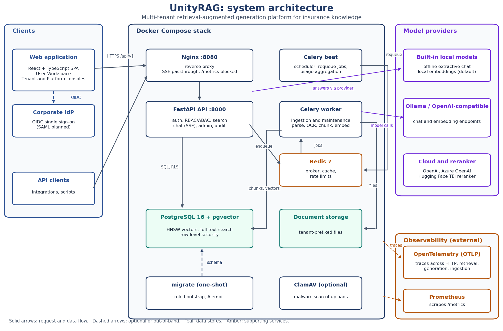
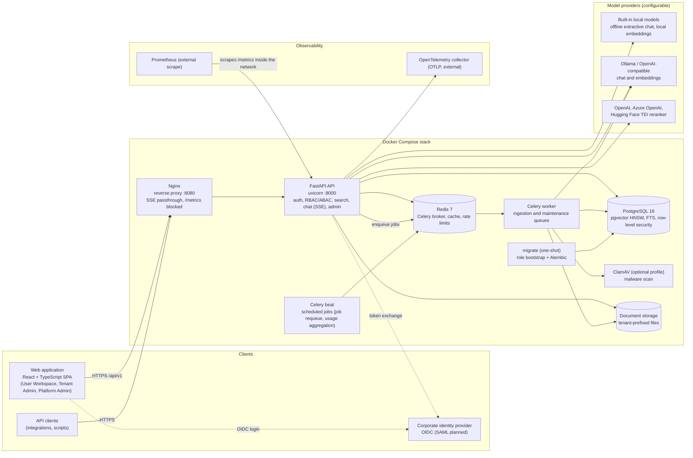
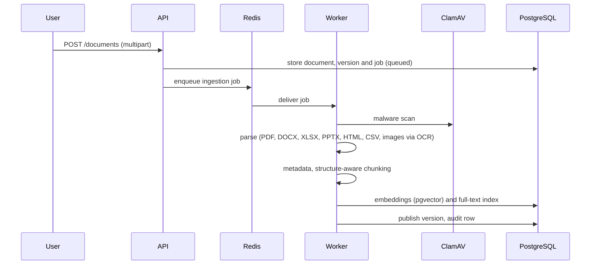
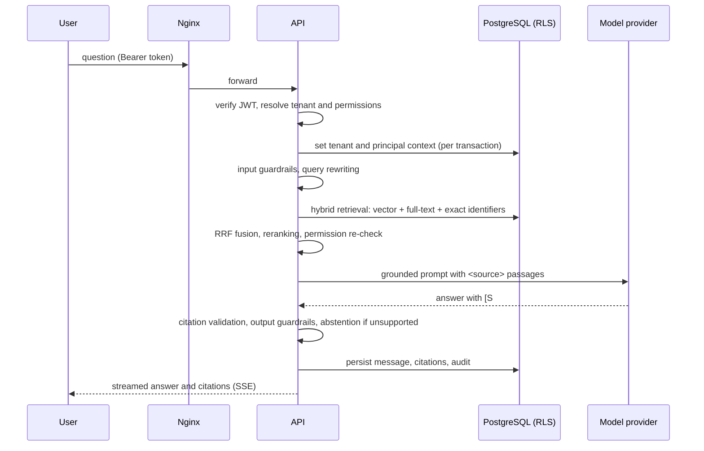

# UnitRAG – Enterprise RAG (Retrieval-Augmented Generation) Platform

**UnityRAG** is a multi-tenant, permission-aware retrieval-augmented generation (RAG) platform for insurance organisations. It lets staff ask natural-language questions across approved policy wordings, underwriting guidelines, claims procedures and product material, and get answers that cite the exact passage they came from, or say plainly that the approved sources do not answer the question.

UnitRAG is an advanced **Enterprise RAG (Retrieval-Augmented Generation) platform** designed to help organizations unlock the full potential of their enterprise data using Generative AI and Large Language Models (LLMs). It enables businesses to build secure, intelligent, and context-aware AI applications that retrieve relevant information from enterprise documents, databases, knowledge bases, and internal systems to generate accurate, reliable, and contextually relevant responses.

Powered by modern **RAG architecture, vector search, semantic search, hybrid search, and AI-powered information retrieval**, UnitRAG transforms unstructured enterprise data into actionable business intelligence. Organizations can implement intelligent enterprise search, AI chatbots, document intelligence, knowledge management, and conversational AI solutions.

UnitRAG focuses on enterprise-grade security, multi-tenancy, role-based access control (RBAC), data governance, document-level permissions, and source citations to ensure that AI-generated responses remain secure, traceable, and grounded in authorized enterprise information.

The platform supports scalable **Generative AI solutions, LLM integration, Retrieval-Augmented Generation pipelines, agentic AI workflows, and enterprise knowledge management**. It helps organizations reduce information discovery time, improve employee productivity, automate knowledge-intensive processes, and make better business decisions.

Whether you are building a private AI assistant, enterprise knowledge platform, intelligent document search solution, or production-ready RAG application, UnitRAG provides a foundation for developing secure, scalable, and trustworthy enterprise AI solutions.


It is a full-stack project: a FastAPI backend with PostgreSQL (pgvector and full-text search), Redis and Celery workers, a LangGraph answer pipeline, and a React and TypeScript web application with three workspaces.

**Contents**

- [Project overview](#project-overview) · [Features](#features) · [Tech stack](#tech-stack)
- [Backend and frontend](#backend-and-frontend) · [System architecture](#architecture)
- [Repository structure](#repository-structure) · [Prerequisites](#prerequisites) · [Environment configuration](#environment-configuration)
- [Quick start (Docker Compose)](#quick-start-docker-compose-and-first-admin-sign-in) · [Local setup without Docker](#local-setup-without-docker)
- [Running the application](#running-the-application) · [Testing](#testing-the-application-locally) · [API documentation](#api-documentation)
- [Deployment](#deployment-guide) · [Docker reference](#docker-reference) · [Troubleshooting](#troubleshooting)
- [Security and performance](#security-and-performance) · [Contributing](#contributing) · [Roadmap](#roadmap-and-status) · [Documentation index](#documentation-index) · [License and acknowledgements](#license-and-acknowledgements)

## License

This project is licensed under the Apache License 2.0 - see the [LICENSE](apache-v2.0) file for details.

## Project Support
Welcome to UnityRAG project! Check [UnityRAG](https://unityrag.com) for more details.

UnityRAG project Documentation! Check [UnityRAG Project Documentation](https://www.roseindia.net/docs/rag/) for more details.

Check Detailed [UnityRAG v1.0 Documentation](https://www.roseindia.net/docs/rag/v1.0/) for more details.

Connect us through Email Support: [sales@roseindia.net](mailto:sales@roseindia.net).

## Project overview

### The problem

Insurance knowledge is scattered and changes constantly. A claims handler may need a wording clause, the underwriting authority for a risk, the procedure for a claim type and the wording that was in force on the loss date, all at once. Searching file shares is slow, and answers from general-purpose chat tools are unacceptable when a wrong figure can affect a customer.

### The approach

UnityRAG answers only from approved, authorised documents. Every statement in an answer is tied to a citation. When the evidence is missing or weak, the system abstains rather than guessing. The AI never approves a claim, accepts a risk or calculates a binding premium; those decisions stay with people.

### Main objectives

- Give staff fast, cited answers from approved sources.
- Enforce access rules in the database, so one tenant can never read another's content.
- Keep an audit trail of what was asked, what was retrieved, which model and prompt answered, and who saw what.
- Let administrators run the platform without writing code: tenants, users, collections, AI providers, evaluation and monitoring.

### Intended users

Claims examiners and adjusters, underwriters, customer service and policy servicing staff, compliance and legal reviewers, knowledge managers who own the content, and platform and tenant administrators.

## Features

- **Cited answers.** Each answer is grounded in retrieved passages supplied to the model. Citations are verified after generation, unsupported statements are removed, and every citation opens the passage in context with the matching text highlighted.
- **Abstention and degraded mode.** If approved sources do not support an answer, the system says so. If the language model is unavailable, it falls back to a search-only answer and says that it did.
- **Hybrid retrieval.** Vector search (pgvector HNSW), full-text search and exact-identifier matching for clause and form numbers are fused with reciprocal rank fusion, then reranked.
- **Document ingestion.** PDF, DOCX, XLSX, PPTX, HTML, TXT and Markdown, CSV, and scanned pages or images (OCR with Tesseract). Uploads are malware-scanned when a scanner is configured, parsed, chunked along the document's structure, embedded and indexed asynchronously, with retries and a dead-letter state.
- **Versions and effective dates.** Documents keep versions. A question can be answered as at a loss or inception date, so the wording in force on that date is used.
- **Row-level tenant isolation.** PostgreSQL row-level security is enforced on every tenant table. Permissions are checked by collection, document, line of business, jurisdiction and clearance before content reaches a model.
- **Strong sign-in.** Local accounts with scrypt password hashing, lockout after repeated failures, TOTP multi-factor authentication with step-up for sensitive actions, rotating refresh tokens, and OIDC single sign-on.
- **Guardrails.** Prompt-injection detection on uploads and questions, masking of personal data, link neutralisation and blocking of regulated-decision wording.
- **Evaluation.** Retrieval and answer metrics (recall@k, MRR, nDCG, citation coverage, faithfulness, abstention accuracy) with configurable release gates.
- **Administration.** Platform console for tenants, plans, quotas, AI providers and monitoring. Tenant console for users, groups, roles, collections, documents, ingestion, AI settings, analytics, feedback and audit.
- **Auditable by design.** Audit events are hash-chained and append-only.

## Tech stack

| Category | Technology | Purpose |
|---|---|---|
| Backend | Python 3.12+, FastAPI, Pydantic v2, uvicorn | REST API under `/api/v1`, request validation, OpenAPI |
| Backend | SQLAlchemy 2 (Core `text()` SQL), Alembic, psycopg 3 | Parameterised data access and migrations |
| Background jobs | Celery 5 with Redis | Ingestion, re-embedding, scheduled jobs |
| AI and RAG | LangChain core, LangGraph | Answer pipeline as a state machine |
| AI and RAG | Built-in local models; Ollama, OpenAI-compatible, Azure OpenAI and Hugging Face TEI endpoints | Chat, embedding and reranking |
| Documents | pypdf, pdfplumber, python-docx, python-pptx, openpyxl, BeautifulSoup, Tesseract OCR | Parsing and OCR |
| Database | PostgreSQL 16, pgvector 0.8, full-text search, row-level security | Data, vectors, search and isolation |
| Cache and broker | Redis 7 | Celery broker, caches, rate limiting |
| Security | PyJWT, cryptography (Fernet), TOTP | Tokens, encryption of secrets, MFA |
| Observability | OpenTelemetry (OTLP), Prometheus client, JSON logs | Traces, metrics, logs |
| Frontend | React 18, TypeScript, Vite | Web application |
| Frontend | TanStack Query and Table, React Router, React Hook Form, Zod | Server state, routing, forms and validation |
| Frontend | Tailwind CSS, Radix UI, lucide-react, Recharts | Styling, accessible components, icons, charts |
| Testing | pytest, Ruff; Vitest, Testing Library, Playwright, ESLint | Backend, frontend and end-to-end tests and linting |
| Infrastructure | Docker, Docker Compose, Nginx 1.27, ClamAV (optional) | Local and single-host deployment |

## Backend and frontend

Most RAG demos stop at "chat with your PDF". UnityRAG starts where enterprise reality begins: many tenants, strict permissions, documents that change every week, and answers someone may have to defend in an audit. Here is how the two halves fit together.

### The backend: a careful brain with guard rails

The backend is a Python 3.12 service built on FastAPI. Its REST API lives under `/api/v1`, with more than 120 endpoints covering authentication, search, chat, documents, ingestion and the two admin consoles. Behind the routers, a services layer holds the business logic and talks to PostgreSQL with parameterised SQL, so every query runs in a transaction that already knows who is asking.

That is the heart of the design. Each request is resolved to a tenant, a user and a set of permissions before any data is touched. PostgreSQL row-level security then enforces the boundary, so even a bug in application code cannot read another tenant's rows. Every endpoint is described in an interactive OpenAPI page, which makes the backend easy to explore, script against and integrate with your own systems.

Documents take their own path. Uploads are queued to Celery workers, which scan them, parse PDF, Word, Excel, PowerPoint, HTML, CSV and scanned images (with OCR), split them along the document's own structure, and store embeddings in pgvector beside a full-text index. Failed jobs are retried and parked in a dead-letter state instead of disappearing.

Answering a question is a LangGraph state machine with explicit steps: validate the input, rewrite the query, authorise, retrieve, rerank, check whether the evidence is sufficient, generate, validate every citation, run output guardrails and finalise. Retrieval fuses vector search, full-text search and exact identifier matching, so a question about "clause 7.3" and a question about "water damage in a basement" both land on the right passage. If the evidence is thin, the system abstains. If the model is down, it falls back to a search-only answer. It never approves or rejects a claim.

### The frontend: one app, three workspaces

The frontend is a React 18 and TypeScript single-page application built with Vite. It serves three audiences from one codebase: the **User Workspace**, where people chat with cited answers, search and browse documents; the **Tenant Admin Console**, for users, collections, ingestion and AI settings; and the **Platform Admin Console**, for tenants, model providers and monitoring.

It uses TanStack Query for server state, React Router for navigation, Tailwind CSS with Radix UI primitives for accessible components, and Recharts for analytics. Answers stream in as they are generated. Every citation opens the exact passage in context, with the matching text highlighted, so checking an answer takes one click.

The frontend holds no authorisation logic of its own. It hides controls a user cannot use, and the backend checks every request again. Developers can explore the whole interface without a running backend using a built-in mock API, and the project ships unit, integration and end-to-end tests.

### Try it yourself

Start with Docker Compose, create the first platform administrator and sign in to the web application. The steps are in [Quick start](#quick-start-docker-compose-and-first-admin-sign-in) below. A first start takes a few minutes while the images build. Then upload a document, ask it a question and click the citation. That moment, when an answer points straight to the sentence it came from, is what UnityRAG is about. Once you have seen it, try the harder questions: a question that should be refused, a user without access to a collection, or a second tenant that must never see the first tenant's documents.

## Architecture

UnityRAG is built as a set of containers around one API. The API and the Celery workers share a PostgreSQL database with pgvector and full-text search, and Redis is used for the task queue and cache. Documents enter through the ingestion pipeline and are answered through a hybrid retrieval and LangGraph generation pipeline. Tenant isolation is enforced by PostgreSQL row-level security, so the application never filters by tenant on its own.

### System diagram



The same diagram in Mermaid, which renders on GitHub and is easy to edit:



### Request flows

**Document ingestion** (asynchronous, per tenant)



**Question answering** (`POST /chat` or `/chat/stream`)



### Components

| Component | Technology | Responsibility |
|---|---|---|
| Web application | React 18, TypeScript, Vite (separate project in `frontend/`) | User Workspace (chat, search, documents), Tenant Admin Console, Platform Admin Console. Holds no authorisation logic |
| Nginx | nginx 1.27 | TLS termination point in production, reverse proxy to the API, SSE without buffering, `/metrics` blocked from outside |
| API | FastAPI, Pydantic v2, uvicorn | Versioned REST API under `/api/v1`, OpenAPI docs in development only, request correlation and tracing |
| Worker | Celery (queues `ingestion`, `maintenance`) | Document parsing, OCR, chunking, embedding, indexing and re-embedding, with retries and a dead-letter state |
| Scheduler | Celery beat | Periodic jobs: requeue of due ingestion jobs (every minute), usage aggregation (every 15 minutes) and worker heartbeat |
| Database | PostgreSQL 16 with pgvector 0.8 | Tenants, identity, documents, chunks, embeddings (HNSW), full-text search, conversations, audit and evaluation data, row-level security |
| Cache and broker | Redis 7 | Celery broker, retrieval and embedding caches (keyed by tenant and permission fingerprint), rate limiting. The answer cache is not enabled |
| Malware scanning | ClamAV (optional `security` profile) | Scans uploads before parsing |
| Storage | Shared volume (`ObjectStorage` protocol) | Original files, tenant-prefixed. S3 or Azure Blob backend is planned |
| Models | Pluggable provider registry | Chat, embedding, reranker and OCR endpoints configured per provider. Built-in offline models are used when no endpoint is configured |
| Observability | OpenTelemetry (OTLP), Prometheus, JSON logs | Traces across HTTP, retrieval, generation and ingestion; metrics; audit-grade logs |

### Key architectural decisions

- **Isolation in the database.** Every tenant table has a restrictive row-level security policy. The application connects with non-superuser roles (`rag_app`, `rag_worker`, `rag_readonly`), and startup refuses credentials that could bypass RLS.
- **Permissions before content.** Permissions are checked before any passage reaches a model, and they are included in every cache key, so a cached answer is never served to a user who could not see its sources.
- **Grounded answers only.** The model may only use passages supplied in `<source>` blocks. Citations are validated after generation, unsupported statements are removed, and the system abstains or runs in a degraded search-only mode when evidence is insufficient. The AI never approves or rejects insurance decisions.
- **Hybrid retrieval.** Vector search (HNSW), full-text search and exact identifier matching are fused with weighted Reciprocal Rank Fusion, then reranked. Every stage is filtered by row-level security and by the document ACL.
- **Audit by design.** Audit events are hash-chained and append-only. Each answer records the model, prompt and guardrail versions used.
- **Asynchronous ingestion.** Uploads are queued and processed by workers with retries and a dead-letter state, so the API stays responsive for large documents.
- **Configuration over code.** Model providers, RAG parameters and guardrail settings are stored in the database and versioned. Changes are audited.

Further detail is in the documentation index below.

## Repository structure

```
EnterpriseRag/
├── README.md
├── Dockerfile                  # backend image: Python 3.12 slim, Tesseract, non-root user
├── docker-compose.yml          # PostgreSQL, Redis, migrate, API, worker, scheduler, Nginx, ClamAV (profile)
├── backend/
│   ├── app/
│   │   ├── main.py             # application factory: middleware, routers, error handlers
│   │   ├── api/v1/             # HTTP routers: auth, documents, search, chat, admin, platform, health
│   │   ├── services/           # business logic and parameterised SQL
│   │   ├── rag/                # parsers, OCR, chunking, embeddings, retrieval, reranking,
│   │   │                       #   generation, citations, guardrails, workflows (LangGraph)
│   │   ├── workers/            # Celery application and tasks (ingestion, maintenance, scheduled jobs)
│   │   ├── security/           # passwords, JWT, TOTP, Fernet encryption, request context
│   │   ├── database/           # one engine per database role, transaction security context, bootstrap
│   │   ├── core/               # settings (environment variables), errors, logging
│   │   └── cli.py              # operator commands: create-platform-admin, seed-demo, aggregate
│   ├── alembic/                # migration environment; versions 0001 to 0014
│   ├── tests/                  # unit, integration, rls, security, rag and e2e suites
│   ├── pyproject.toml          # Ruff and pytest configuration
│   ├── requirements.txt        # pinned runtime dependencies
│   ├── requirements-dev.txt    # runtime dependencies plus pytest and Ruff
│   └── .env.example            # configuration template (copy to backend/.env)
├── frontend/
│   ├── src/                    # app shell and routes, feature folders, API services, schemas, styles
│   ├── tests/                  # unit and integration tests (Vitest), end-to-end specs (Playwright)
│   ├── index.html, vite.config.ts, playwright.config.ts
│   └── .env.example            # frontend configuration template (copy to frontend/.env)
├── database/                   # SQL source of truth: roles, schema, RLS policies, functions, seed data
├── infrastructure/nginx/       # reverse proxy configuration
├── scripts/                    # setup, start, migrate, test, benchmark and documentation generators
├── docs/                       # requirements, architecture, API reference, security, deployment, operations
└── PROJECT_*.md                # implementation plan, status report, architecture decisions
```

Some files in the repository are not part of the running application and can be removed after review: `backend/testnt.py` (empty), `backend/multi-agent-system/` (a separate Docker folder that the application does not use), `backend/Dockerfile_notused`, `backend/requirements copy.txt` (a duplicate of `requirements.txt`), `req.json` (a sample Ollama request body), and `docs/deployment/~$*.docx` (an Office lock file).

## Prerequisites

### Mandatory for the Docker path

| Requirement | Notes |
|---|---|
| Git | To clone the repository |
| Docker Desktop (Windows, macOS) or Docker Engine with Compose v2 | Runs PostgreSQL, Redis, the API, the worker, the scheduler and Nginx |
| Ports 5432, 6379, 8000 and 8080 free | Used by the containers on your machine |

### Mandatory for the local path (without Docker)

| Requirement | Notes |
|---|---|
| Python 3.12 or newer | `backend/pyproject.toml` requires 3.12+; the Docker image uses 3.12 |
| PostgreSQL 16 with the pgvector 0.8 extension | Needs a superuser connection for the one-time bootstrap |
| Redis 7 | Celery broker and cache |
| Node.js 20 or newer and npm | Only for the web application |

### Optional

| Tool or service | When you need it |
|---|---|
| Tesseract OCR | Scanned pages and images. Installed in the Docker image; on the host, install it and set `TESSERACT_CMD` if it is not on `PATH` |
| ClamAV | Malware scanning of uploads. Start it with the `security` Compose profile; mandatory in production |
| A language-model endpoint | Ollama, an OpenAI-compatible server, Azure OpenAI or a Hugging Face TEI reranker. Without one, the built-in offline models are used. Keys are entered in the Platform console, not in `.env` |
| An OIDC identity provider | Corporate single sign-on (`AUTH_MODE=oidc` or `both`) |
| Google Chrome or Microsoft Edge | Playwright end-to-end tests of the frontend |

### Supported platforms and resources

- **Verified:** Windows 11 with Docker Desktop and PowerShell. The Docker stack and the README commands were run on this platform.
- **Provided but not verified here:** Linux and macOS. The `.sh` scripts in `scripts/` are written for them.
- **Resources:** no benchmark of minimum hardware has been made. The Compose stack runs six containers, so give Docker enough memory for PostgreSQL, the API and the workers, and enough disk for the document volume.

## Environment configuration

The backend reads its settings from environment variables, and from `backend/.env` when it exists. Each variable is the upper-case name of a setting in `backend/app/core/config.py`. The tables below list the settings you are most likely to change. The full list is in `backend/app/core/config.py`.

**Never commit real secrets.** `backend/.env` is listed in `.gitignore`. The values in the table are placeholders.

### Backend (`backend/.env`)

| Variable | Description | Required | Default in code | Example |
|---|---|---|---|---|
| `ENVIRONMENT` | `development`, `test`, `staging` or `production`. Production enables strict checks | No | `development` | `development` |
| `DB_HOST`, `DB_PORT`, `DB_NAME` | PostgreSQL address and database | Yes (for the local path) | `localhost`, `5432`, `enterprise_rag` | `localhost`, `5432`, `enterprise_rag` |
| `DB_SSLMODE` | PostgreSQL SSL mode. Use `require` or `verify-full` in production | No | `prefer` | `prefer` |
| `DB_APP_USER`, `DB_APP_PASSWORD` | Role used by the API. Must be `rag_app` | Yes in production | `rag_app`, `devpass` | `<strong-password>` |
| `DB_WORKER_USER`, `DB_WORKER_PASSWORD` | Role used by Celery workers | Yes in production | `rag_worker`, `devpass` | `<strong-password>` |
| `DB_READONLY_USER`, `DB_READONLY_PASSWORD` | Read-only reporting role | Yes in production | `rag_readonly`, `devpass` | `<strong-password>` |
| `DB_MIGRATION_USER`, `DB_MIGRATION_PASSWORD` | Role that runs Alembic migrations | Yes in production | `rag_migration`, `devpass` | `<strong-password>` |
| `DB_SUPERUSER_DSN` | Superuser connection string, used only by the bootstrap and the migration service | Local path only | none | `host=localhost user=postgres password=<password> dbname=postgres` |
| `REDIS_URL` | Redis connection URL for the broker and cache | Yes | `redis://localhost:6379/0` | `redis://localhost:6379/0` |
| `CACHE_BACKEND` | `redis` or `memory` | No | `redis` | `redis` |
| `CELERY_TASK_ALWAYS_EAGER` | Run tasks in the API process. Useful for single-process development | No | `false` | `false` |
| `AUTH_MODE` | `local`, `oidc` or `both` | No | `both` | `both` |
| `JWT_SECRET` | Signing key for access tokens. At least 32 characters; production refuses the development value | Yes in production | development value | `<64 random characters>` |
| `JWT_ISSUER`, `JWT_AUDIENCE` | Token issuer and audience | No | `enterprise-rag`, `enterprise-rag-api` | (keep the defaults) |
| `ACCESS_TOKEN_MINUTES`, `REFRESH_TOKEN_HOURS` | Token lifetimes | No | `10`, `12` | `10`, `12` |
| `OIDC_ISSUER`, `OIDC_AUDIENCE`, `OIDC_JWKS_URL` | Corporate identity provider settings | Only with `AUTH_MODE=oidc` or `both` | none | from your identity provider |
| `SECRETS_ENCRYPTION_KEY` | Fernet key that encrypts stored secrets such as provider keys and MFA secrets | Yes in production | derived from `JWT_SECRET` in development | `<Fernet key>` |
| `STORAGE_ROOT` | Folder for uploaded originals | No | `./var/storage` | `./var/storage` |
| `MALWARE_SCANNER` | `none` or `clamav`. Production requires `clamav` | Yes in production | `none` | `none` |
| `CLAMAV_HOST`, `CLAMAV_PORT` | ClamAV address | Only with `clamav` | `localhost`, `3310` | `localhost`, `3310` |
| `TESSERACT_CMD` | Path to the Tesseract executable, if it is not on `PATH` | Only for OCR on the host | none | `C:\Program Files\Tesseract-OCR\tesseract.exe` |
| `OCR_LANGUAGES` | Tesseract languages | No | `eng` | `eng` |
| `RATE_LIMIT_PER_MINUTE`, `CHAT_RATE_LIMIT_PER_MINUTE` | Request limits per client | No | `120`, `20` | `120`, `20` |
| `MAX_REQUEST_BYTES` | Largest accepted request body | No | `629145600` (600 MB) | `629145600` |
| `CORS_ORIGINS` | Allowed browser origins, as a JSON list | No | `["http://localhost:5173","http://localhost:3000"]` | `["http://localhost:5173"]` |
| `LOG_LEVEL` | Logging level | No | `INFO` | `INFO` |
| `METRICS_ENABLED` | Expose `/metrics` for scraping | No | `true` | `true` |
| `OTEL_ENABLED` | Export traces over OTLP/HTTP. Set the standard `OTEL_EXPORTER_OTLP_*` variables as well | No | `false` | `false` |
| `OTEL_SERVICE_NAME` | Service name on traces | No | `unityrag` | `unityrag` |
| `DEMO_PASSWORD` | Password for the demo accounts created by `seed-demo` | Only for `seed-demo` | none | `<strong-password>` |

### Frontend (`frontend/.env`)

| Variable | Description | Required | Example |
|---|---|---|---|
| `VITE_API_BASE_URL` | API prefix the browser calls. Use `/api/v1` behind a same-origin proxy to avoid CORS | Yes | `http://localhost:8000/api/v1` |
| `VITE_APP_NAME` | Name shown in the interface | No | `UnityRAG` |
| `VITE_AUTH_MODES` | Sign-in options on the login page: `local`, `oidc` or both | Yes | `local` |
| `VITE_OIDC_START_URL`, `VITE_OIDC_DISPLAY_NAME` | Single sign-on button target and label | Only with OIDC | from your identity provider |
| `VITE_ENABLE_MOCK_API` | `true` runs the interface on built-in sample data, without a backend. Development only | No | `false` |
| `VITE_CHAT_STREAMING` | `false` uses `POST /chat` instead of server-sent events | No | `true` |
| `VITE_SESSION_IDLE_MINUTES` | Idle time before the session warning | No | `30` |

### Generating the secrets

```bash
python -c "import secrets; print(secrets.token_urlsafe(48))"                                  # JWT_SECRET
python -c "from cryptography.fernet import Fernet; print(Fernet.generate_key().decode())"     # SECRETS_ENCRYPTION_KEY
```

The second command needs the `cryptography` package, which is in `backend/requirements.txt`.

### Where API keys for language models go

Provider keys are not environment variables. Add a provider in the **Platform console** (AI and RAG, then Providers). Keys are encrypted with `SECRETS_ENCRYPTION_KEY` and are never shown again after they are saved. Obtain a key from the provider's own console, for example the OpenAI or Azure portal. Ollama needs no key.

## Quick start (Docker Compose) and first admin sign-in

Follow these steps in order. They start the full stack with Docker Compose, create the first platform administrator, and sign in.

### 1. Check the prerequisites

- Docker Desktop (Windows or macOS) or Docker Engine with Compose v2. Start it, then check that the engine responds:

  ```bash
  docker info
  ```

- Ports 5432, 6379, 8000 and 8080 are free on your machine.
- For the web application (step 5, option A): Node.js 20 or newer.

### 2. Create the environment file

If `backend/.env` does not exist, create it from the template. Skip this step if the file is already there and its values are set.

```bash
cp backend/.env.example backend/.env
```

On Windows PowerShell: `Copy-Item backend\.env.example backend\.env`

Edit `backend/.env` and replace every `change-me` value. You must set:

- `JWT_SECRET`: at least 64 random characters.
- `SECRETS_ENCRYPTION_KEY`: a Fernet key.
- `DB_APP_PASSWORD`, `DB_WORKER_PASSWORD`, `DB_READONLY_PASSWORD` and `DB_MIGRATION_PASSWORD`: database role passwords.

To generate the two secrets:

```bash
python -c "import secrets; print(secrets.token_urlsafe(48))"
python -c "from cryptography.fernet import Fernet; print(Fernet.generate_key().decode())"
```

The second command needs the `cryptography` package (`pip install cryptography`).

### 3. Start the stack

```bash
docker compose up -d --build
```

On Windows you can use `.\scripts\start.ps1` instead, which runs the same command. The first start builds the images and takes several minutes. A one-shot `migrate` service creates the database and runs the migrations, then exits. The API starts after it succeeds.

Check that the stack is ready:

```bash
curl http://localhost:8000/health/ready
```

Expected response: `{"status":"ready", ...}`. If it is not ready after about two minutes, run `docker compose logs migrate api` to see the error.

### 4. Create the first platform administrator

```bash
docker compose exec api python -m app.cli create-platform-admin --email admin@example.com
```

The command asks for a password. Run it in an interactive terminal. The password must be at least 12 characters and contain upper- and lower-case letters, a digit and a symbol.

If the email already exists, the command only grants the platform administrator role again. It does not change the password.

To set the password on the command line instead (for scripts only, because it is kept in your shell history), use the `=` form. The `=` form is required when the password starts with `-`:

```bash
docker compose exec api python -m app.cli create-platform-admin --email admin@example.com --password='Choose-A-Strong#Pass1'
```

### 5. Sign in as the administrator

Choose one of the two options.

**Option A: web application**

```bash
cd frontend
npm install
npm run dev
```

Open http://localhost:5173/login, enter the administrator email and password, and select **Sign in**. You are taken to the Platform dashboard.

The frontend reads `frontend/.env`. If it is missing, copy `frontend/.env.example` to `frontend/.env`. Check that `VITE_API_BASE_URL=http://localhost:8000/api/v1` and `VITE_AUTH_MODES=local` are set.

**Option B: API**

```bash
curl -s -X POST http://localhost:8000/api/v1/auth/login \
  -H "Content-Type: application/json" \
  -d '{"email":"admin@example.com","password":"<your password>"}'
```

The response contains an `access_token`. Use it to check the session:

```bash
curl -s http://localhost:8000/api/v1/auth/me -H "Authorization: Bearer <access_token>"
```

The response shows `"platform_role": "platform_super_admin"`. The access token expires after 10 minutes (`ACCESS_TOKEN_MINUTES`). Use the `refresh_token` with `POST /api/v1/auth/refresh` to get a new one.

Five failed sign-in attempts lock the account for 15 minutes.

### 6. Continue setup

- In the Platform console, or with `POST /api/v1/platform/tenants`, create a tenant and its first tenant administrator. See [API documentation](#api-documentation).
- Optional demo data: `docker compose exec api python -m app.cli seed-demo` creates two demo tenants. It needs `DEMO_PASSWORD` in `backend/.env`.

### 7. Stop the stack

```bash
docker compose down
```

This stops and removes the containers and keeps the data. To delete the database, Redis data and stored documents as well, run `docker compose down -v`. That cannot be undone.

### Service addresses

| What | Where |
|---|---|
| Web application (after step 5, option A) | http://localhost:5173 |
| API docs (development only) | http://localhost:8000/docs |
| Through Nginx | http://localhost:8080 |
| Readiness | http://localhost:8000/health/ready |

## Local setup without Docker

Use this path when you want to run the API and worker from a virtual environment, for example to debug them in an IDE. You still need PostgreSQL 16 with pgvector and Redis, which you can start from the Compose file.

**1. Clone the repository**

```bash
git clone <your-repository-url> EnterpriseRag
cd EnterpriseRag
```

**2. Create the virtual environment and install the dependencies**

Windows PowerShell:

```powershell
python -m venv .venv
.\.venv\Scripts\Activate.ps1
python -m pip install --upgrade pip
pip install -r backend\requirements-dev.txt
```

Linux and macOS:

```bash
python3 -m venv .venv
source .venv/bin/activate
pip install --upgrade pip
pip install -r backend/requirements-dev.txt
```

`requirements-dev.txt` adds pytest and Ruff. The helper scripts `scripts\setup.ps1` and `scripts/setup.sh` do steps 2 and 3 for you.

**3. Create the configuration file**

Windows PowerShell:

```powershell
Copy-Item backend\.env.example backend\.env
```

Linux and macOS:

```bash
cp backend/.env.example backend/.env
```

Edit `backend/.env`. For local development the defaults work with the Compose PostgreSQL and Redis, except `DB_SUPERUSER_DSN`, which the bootstrap needs. Set `DB_HOST=localhost` and `REDIS_URL=redis://localhost:6379/0` if they still point at the Compose service names.

**4. Start PostgreSQL and Redis**

```bash
docker compose up -d postgres redis
```

This starts only the two data services from `docker-compose.yml`. They use the port mappings 5432 and 6379.

**5. Create the database roles and apply the migrations**

Windows PowerShell:

```powershell
.\scripts\migrate.ps1
```

Linux and macOS:

```bash
scripts/migrate.sh
```

The scripts run `python -m app.database.bootstrap` (creates the roles, database and extensions, using `DB_SUPERUSER_DSN`) and then `alembic upgrade head` (applies migrations 0001 to 0014). They are safe to run again.

**6. Create the first platform administrator**

```bash
python scripts/create_admin.py --email admin@example.com
```

The command asks for a password. The rules are described in [Quick start](#quick-start-docker-compose-and-first-admin-sign-in).

**7. Models and datasets**

No model download is required. The built-in offline models run without an external service. To use a real language model, add a provider in the Platform console. Ollama, for example, needs the model pulled on that server (`ollama pull llama3.1:8b` and `ollama pull nomic-embed-text`). The golden datasets for evaluation are created in the Tenant console.

**8. Start the API and the worker**

Windows PowerShell, which starts the API, the worker and the scheduler in the virtual environment:

```powershell
.\scripts\start.ps1 -Local
```

Linux and macOS:

```bash
scripts/start.sh --local
```

The API listens on port 8000. The worker uses the `ingestion` and `maintenance` queues. On Windows the worker uses the `solo` pool, because the default pool does not run there.

**9. Start the web application (optional)**

```bash
cd frontend
npm install
npm run dev
```

Open http://localhost:5173. Copy `frontend/.env.example` to `frontend/.env` first if the file does not exist.

## Running the application

| What | Where | Notes |
|---|---|---|
| API root | http://localhost:8000/api/v1 | All endpoints are under this prefix |
| Interactive API docs | http://localhost:8000/docs | Development only. Disabled when `ENVIRONMENT=production` |
| OpenAPI document | http://localhost:8000/api/v1/openapi.json | Development only |
| Readiness | http://localhost:8000/health/ready | Returns `{"status":"ready", ...}` when the database, pgvector and cache are reachable |
| Liveness | http://localhost:8000/health/live | Used by the container health check |
| Web application | http://localhost:5173 | Vite development server |
| Through Nginx (Compose) | http://localhost:8080 | Reverse proxy in front of the API |

**Start:** use the commands in the Docker or local sections above.

**Stop:**

- Local path: press `Ctrl+C` in each terminal (API, worker and frontend). On Linux and macOS, `scripts/start.sh --local` stops the worker and scheduler when it exits. On Windows, close the worker and scheduler windows that `start.ps1 -Local` opened.
- Docker: `docker compose down`. See [Docker reference](#docker-reference).

**Verify that it started:**

```bash
curl http://localhost:8000/health/ready
```

Expected: `{"status":"ready","checks":{"database":"ok","pgvector":"0.8.1","cache":"ok"}}`. If the response is missing or the status is not `ready`, see [Troubleshooting](#troubleshooting).

## Testing the application locally

### Automated backend tests

The backend suite runs against a real PostgreSQL 16 database with pgvector. It creates a fresh `rag_pytest` database through the real bootstrap and migrations, and then runs the tests as the non-superuser roles, so the row-level security checks are real. Set the superuser connection string for the test database first.

Windows PowerShell:

```powershell
cd backend
$env:TEST_DB_SUPERUSER_DSN = "host=127.0.0.1 user=postgres password=postgres dbname=postgres"
python -m pytest tests -q
```

Linux and macOS:

```bash
cd backend
TEST_DB_SUPERUSER_DSN="host=127.0.0.1 user=postgres password=postgres dbname=postgres" python -m pytest tests -q
```

The script `scripts/run_tests.sh` runs the same command. The `postgres` superuser in the example is the default of the Compose PostgreSQL service. Change it if your database uses a different password.

| Task | Command |
|---|---|
| One test file | `python -m pytest tests/rag/test_providers_and_workflow.py -q` |
| One test by name | `python -m pytest tests -q -k "citation"` |
| Verbose output | `python -m pytest tests -v` |
| One suite | `python -m pytest tests/rls -q` (suites: `unit`, `integration`, `rls`, `security`, `rag`, `e2e`) |
| Without a database | `python -m pytest tests/unit tests/rag -q`. Tests that need PostgreSQL are skipped when it is not reachable |

Tests that call external language models, embedding services or OIDC providers use mocks. Everything else runs for real, including PostgreSQL, pgvector, full-text search, Tesseract, LangGraph and Celery in eager mode.

### Linting

```bash
cd backend
python -m ruff check app tests
```

Ruff reads its settings from `backend/pyproject.toml`.

### Frontend checks

```bash
cd frontend
npm run typecheck
npm run lint
npm run test
```

`npm run test:e2e` runs the Playwright journeys in Google Chrome (set `E2E_CHANNEL=msedge` for Edge). The journeys stub the backend at the network layer, so the backend does not need to run.

### Checking the API by hand

Sign in and keep the token:

```bash
curl -s -X POST http://localhost:8000/api/v1/auth/login \
  -H "Content-Type: application/json" \
  -d '{"email":"admin@example.com","password":"<your password>"}'
```

Search approved content (needs a user with `search.use`, and access to a collection):

```bash
curl -s -X POST http://localhost:8000/api/v1/search \
  -H "Authorization: Bearer <access_token>" -H "Content-Type: application/json" \
  -d '{"query":"flood damage to a basement","mode":"hybrid","top_k":5}'
```

Ask a question (needs `chat.use`):

```bash
curl -s -X POST http://localhost:8000/api/v1/chat \
  -H "Authorization: Bearer <access_token>" -H "Content-Type: application/json" \
  -d '{"message":"Is flood damage to a basement covered?"}'
```

The response contains the answer, its status (`answered`, `abstained`, `blocked` or `needs_review`), the evidence strength and a `citations` list. An answer with no evidence has status `abstained` and says so. Use `POST /api/v1/chat/stream` for the same request as server-sent events.

### Checking database connectivity

- The readiness endpoint reports `"database":"ok"` only when the application role can connect and pgvector is installed.
- Direct check with the Compose database: `docker compose exec postgres psql -U postgres -d enterprise_rag -c "select extversion from pg_extension where extname='vector';"`

### Checking external integrations

- Model providers: sign in as a platform administrator, open the Platform console (AI and RAG, then Providers) and select **Health check**. The same check is available through `POST /api/v1/platform/ai-providers/{provider_id}/health-check`.
- Ollama, directly on its server: `curl http://<ollama-host>:11434/api/tags` lists the installed models.
- Platform monitoring (API, PostgreSQL, Redis, worker, queue and providers): `GET /api/v1/platform/monitoring`.

### Testing the main workflow end to end

1. As a tenant administrator, create a collection and grant a test user access to it.
2. Upload a document to that collection (`POST /api/v1/documents`, multipart) and watch its job with `GET /api/v1/ingestion/jobs/{job_id}`. The job must reach `succeeded`. The worker must be running for this step.
3. Search for a sentence from the document. The passage must appear with its title and page.
4. Ask a question the document answers. The answer must cite the document, and the citation must open the passage.
5. Ask a question the documents do not answer. The answer must abstain.
6. Sign in as a user without access to the collection and repeat step 4. The answer must not use the document.

### Coverage and gaps

The backend suite contains 116 passing tests and 1 skipped test (Tesseract is not installed on the machine where it was last run). Features that are not built yet, such as source connectors, SAML, SCIM and the answer cache, have no tests. See [Roadmap and status](#roadmap-and-status).

## API documentation

The complete reference is generated from the code: open `/docs` in development, or read `docs/api/API_REFERENCE.md` and `docs/api/openapi.json`. The API has 127 paths and 153 operations, grouped by the consoles that use them.

**Authentication.** Sign in with `POST /api/v1/auth/login` and send the access token as `Authorization: Bearer <token>`. Access tokens expire after 10 minutes. `POST /api/v1/auth/refresh` rotates the refresh token. Requests are checked for the permission each endpoint needs, and for the active tenant.

**Errors.** Errors use one shape, with a stable `code`, a human-readable `message` and a `correlation_id` that matches the server log:

```json
{"error":{"code":"invalid_credentials","message":"Invalid credentials","correlation_id":"1b7f29966e004eab8475a46f336e1661","details":[]}}
```

**Rate limits.** Each client is limited to 120 requests a minute, and chat to 20 a minute by default (`RATE_LIMIT_PER_MINUTE`, `CHAT_RATE_LIMIT_PER_MINUTE`). The limits are per user and tenant. Redis holds the counters.

**Key endpoints**

| Method | Endpoint | Description | Authentication |
|---|---|---|---|
| POST | `/api/v1/auth/login` | Password sign-in (local accounts); returns tokens and the tenant list | Not required |
| POST | `/api/v1/auth/oidc/exchange` | Exchange a corporate identity-provider token for a session | Not required |
| POST | `/api/v1/auth/refresh` | Rotate the refresh token and issue a new access token | Not required |
| GET | `/api/v1/auth/me` | Current user, active tenant, roles and effective permissions | Required |
| POST | `/api/v1/auth/mfa/enroll` | Start TOTP enrolment | Required |
| POST | `/api/v1/auth/mfa/verify` | Confirm enrolment or perform step-up verification | Required |
| POST | `/api/v1/search` | Hybrid, vector or full-text search over authorised content | Required |
| GET | `/api/v1/search/facets` | Filter values with counts, limited to what the caller may see | Required |
| POST | `/api/v1/chat` | Ask a question; answer with citations, evidence strength and status | Required |
| POST | `/api/v1/chat/stream` | The same as `/chat`, streamed as server-sent events | Required |
| GET | `/api/v1/conversations` | List the caller's conversations | Required |
| GET | `/api/v1/conversations/{conversation_id}/messages/{message_id}/sources` | Citations of an answer, re-checked against current access | Required |
| POST | `/api/v1/documents` | Upload a document to a collection; returns the document and its ingestion job | Required |
| POST | `/api/v1/documents/{document_id}/versions` | Upload a new version of a document | Required |
| GET | `/api/v1/documents/{document_id}/preview` | Preview a page, or the page of a cited passage (personal data masked) | Required |
| GET | `/api/v1/documents/{document_id}/download` | Download the original file; access is checked at request time | Required |
| GET | `/api/v1/ingestion/jobs/{job_id}` | Status of an ingestion job | Required |
| POST | `/api/v1/feedback` | Rate an answer or report an issue | Required |
| GET | `/api/v1/admin/users` | List or search users in the active tenant | Required (tenant administrator) |
| POST | `/api/v1/admin/users` | Create a user, or add an existing identity to the tenant | Required (tenant administrator) |
| GET | `/api/v1/admin/collections` | List collections | Required (tenant administrator) |
| PUT | `/api/v1/admin/collections/{collection_id}/access` | Assign users, groups, roles or departments to a collection | Required (tenant administrator) |
| GET | `/api/v1/admin/permissions/effective/{user_id}` | Effective permissions of a user, for troubleshooting access | Required (tenant administrator) |
| GET | `/api/v1/admin/ingestion/jobs` | All ingestion jobs, with retry and cancel actions | Required (tenant administrator) |
| GET | `/api/v1/platform/tenants` | List tenants | Required (platform administrator) |
| POST | `/api/v1/platform/tenants` | Create a tenant, optionally with its first administrator | Required (platform administrator) |
| GET | `/api/v1/platform/monitoring` | Health of the API, database, Redis, worker, queue and providers | Required (platform administrator) |

**Example: create a tenant with its first administrator**

```bash
curl -X POST http://localhost:8000/api/v1/platform/tenants \
  -H "Authorization: Bearer <access_token>" -H "Content-Type: application/json" \
  -d '{"code":"abc-general","name":"ABC General","plan_code":"professional","admin_email":"admin@abc.example","admin_name":"ABC Admin","admin_password":"<strong password, 12+ characters>"}'
```

Valid plan codes are `trial`, `starter`, `professional` and `enterprise`. The tenant code must be lower-case letters, digits and hyphens.

**Next steps after creating a tenant**

1. Sign in as the tenant administrator.
2. Create a group and a collection: `POST /api/v1/admin/groups`, `POST /api/v1/admin/collections`.
3. Create users: `POST /api/v1/admin/users`.
4. Upload documents: `POST /api/v1/documents`.
5. Search and chat: `POST /api/v1/search`, `POST /api/v1/chat`.

## Deployment guide

The repository provides a Docker Compose stack for a single host and a Dockerfile for the backend. It does not provide Kubernetes manifests, cloud infrastructure code or a CI pipeline. Treat the guidance below as a starting point, and verify each item in your own environment.

### Production prerequisites

- A host with Docker Engine and Compose v2, and enough memory and disk for PostgreSQL, the document volume and the workers.
- A TLS certificate and a reverse proxy or load balancer in front of Nginx. The Nginx configuration in `infrastructure/nginx/` listens on port 80 only.
- A corporate identity provider with OIDC (SAML is not yet supported; see the roadmap).
- A malware scanner. Production refuses to start without one.
- A secrets store for the values in `backend/.env`, or a protected copy of that file on the host.

### Production environment variables

Set these in `backend/.env` on the server:

- `ENVIRONMENT=production`
- `JWT_SECRET`: at least 32 characters, not the development value.
- `SECRETS_ENCRYPTION_KEY`: a Fernet key. Keep it safe; losing it means stored provider keys cannot be decrypted.
- `DB_APP_PASSWORD`, `DB_WORKER_PASSWORD`, `DB_READONLY_PASSWORD`, `DB_MIGRATION_PASSWORD`: not `devpass`.
- `MALWARE_SCANNER=clamav` and start the stack with the `security` profile.
- `DB_SSLMODE=require` (or `verify-full`) when PostgreSQL is not on the same host.
- `AUTH_MODE=oidc` if local passwords must not be used. Then set `OIDC_ISSUER`, `OIDC_AUDIENCE` and `OIDC_JWKS_URL`.
- `CORS_ORIGINS` set to your web application's origin only.

The application refuses to start in production when these checks fail, and tells you which one. Startup also checks that the application roles cannot bypass row-level security.

### Option A: Docker Compose on one host

1. Copy the repository to the server and create `backend/.env` as described above.
2. Build and start the stack:

   ```bash
   docker compose up -d --build
   docker compose --profile security up -d clamav
   ```

3. Wait until `curl http://localhost:8000/health/ready` returns `ready`.
4. Create the first platform administrator (see the Quick start section).
5. Put the TLS-terminating proxy in front of port 8080 (Nginx) or of port 8000 (the API), and forward the `X-Forwarded-*` headers.

The API image starts uvicorn with `--proxy-headers --workers 2`. Nginx allows request bodies up to 600 MB and does not buffer server-sent events. It blocks `/metrics` from outside the network.

### Option B: run the backend without Docker

Run the API, worker and scheduler in separate processes from a virtual environment, with PostgreSQL and Redis provided by your platform:

```bash
cd backend
uvicorn app.main:app --host 0.0.0.0 --port 8000 --proxy-headers --workers 2
celery -A app.workers.celery_app worker -Q ingestion,maintenance --loglevel=INFO --concurrency=2
celery -A app.workers.celery_app beat --loglevel=INFO
```

Run the database bootstrap and migrations once per release, with the migration role, before starting the processes (`scripts/migrate.sh`).

### Ports, storage and health checks

| Item | Value |
|---|---|
| API | 8000 |
| Nginx (Compose) | 8080 mapped to container port 80 |
| PostgreSQL | 5432 (restrict it to the application network in production) |
| Redis | 6379 (restrict it to the application network in production) |
| Persistent data | Docker volumes `pgdata`, `redisdata` and `storage` (document originals) |
| Health checks | `/health/live` (liveness) and `/health/ready` (readiness, checks the database, pgvector and cache) |
| Logs | JSON lines on standard output, one per request, with the correlation ID |

Back up the `pgdata` volume and the `storage` volume together. Documents and their index entries must stay consistent.

### Deployment verification

1. `/health/ready` returns `ready`.
2. Sign in as the platform administrator and open the Platform console. The monitoring page shows every component as healthy.
3. Upload a test document, wait for its job to succeed, and ask a question about it.
4. Check that `http://<host>:8000/docs` does not respond in production, and that `/metrics` is not reachable through Nginx.

### Common deployment failures

| Symptom | Likely cause and fix |
|---|---|
| The API exits at start with a message about `JWT_SECRET` or `SECRETS_ENCRYPTION_KEY` | Production checks failed. Set both values as described above |
| The API exits with "credentials would bypass row-level security" | `DB_APP_USER` is not `rag_app`, or the role has superuser rights. Use the roles created by the bootstrap |
| "a malware scanner is mandatory in production" | Set `MALWARE_SCANNER=clamav` and start ClamAV |
| Uploads stay queued | The worker is not running or cannot reach Redis |
| Browser requests fail with CORS errors | Add the web origin to `CORS_ORIGINS` |
| Large uploads fail with 413 | Raise `client_max_body_size` in the Nginx configuration and `MAX_REQUEST_BYTES` |
| Server-sent events arrive in one block | A proxy in front of Nginx buffers responses. Disable buffering for `/api/v1/chat/stream` |

## Docker reference

| Task | Command |
|---|---|
| Build and start every service | `docker compose up -d --build` |
| Start with the optional ClamAV scanner | `docker compose --profile security up -d` |
| Show the service status | `docker compose ps` |
| Read the logs of one service | `docker compose logs -f api` (also `worker`, `scheduler`, `migrate`, `postgres`, `redis`, `nginx`) |
| Rebuild after code changes | `docker compose up -d --build api worker scheduler` |
| Run a command in the API container | `docker compose exec api python -m app.cli --help` |
| Open a PostgreSQL shell | `docker compose exec postgres psql -U postgres -d enterprise_rag` |
| Stop the stack and keep data | `docker compose down` |
| Stop the stack and delete all data | `docker compose down -v` (deletes the database, Redis data and document storage) |
| Remove unused images | `docker image prune` (only images that no container uses) |

The Compose file builds the backend image from the root `Dockerfile`. The `migrate` service runs once, before the API starts. The API image runs as the non-root user `rag`.

## Troubleshooting

| Problem | Possible cause | Solution |
|---|---|---|
| `error during connect` or `dockerDesktopLinuxEngine` | Docker Desktop is not running | Start Docker Desktop, then check with `docker info` |
| `DB_SUPERUSER_DSN must be set for bootstrap` | Local path without the superuser connection | Add `DB_SUPERUSER_DSN` to `backend/.env`. It is needed only for the bootstrap and migrations |
| `extension "vector" is not available` | pgvector is not installed for PostgreSQL 16 | Install pgvector 0.8 (`postgresql-16-pgvector`), or use the `pgvector/pgvector:0.8.1-pg16` image |
| The API refuses to start: "credentials would bypass row-level security" | `DB_APP_USER` is `postgres`, `rag_migration` or another privileged role | Set `DB_APP_USER=rag_app` |
| Production refuses to start | Development values remain in `JWT_SECRET`, database passwords or `MALWARE_SCANNER` | Set the production values listed in the deployment guide |
| Dependency installation fails | Python older than 3.12, or a stale virtual environment | Use Python 3.12 or newer, delete `.venv` and run the setup again |
| `/health/ready` is not `ready` | Database role, password or pgvector problem | Run `docker compose logs migrate api`. Check that `DB_*_PASSWORD` in `backend/.env` matches the password used at the first start |
| Port already in use (5432, 6379, 8000, 8080 or 5173) | Another program uses the port | Stop that program, or change the host port in `docker-compose.yml` or the Vite configuration |
| Empty search results for every user | The user has no access to the collection, or the tenant is suspended | Check `GET /api/v1/admin/permissions/effective/{user_id}` and the collection access |
| Uploads stay `queued` | The worker is not running | Start it with `scripts/start.sh --local` or `docker compose up -d worker`. Or set `CELERY_TASK_ALWAYS_EAGER=true` for single-process development |
| A document ends in `failed` with "contact an administrator" | The security check quarantined it, for example a PDF with embedded scripts | The document needs review. Quarantine review is planned for v1.1 |
| OCR pages are empty | Tesseract is missing | Install Tesseract, or set `TESSERACT_CMD` to its path |
| Windows: Celery exits immediately | The default pool does not run on Windows | Use `.\scripts\start.ps1 -Local`, which uses the `solo` pool |
| Tests are skipped | `TEST_DB_SUPERUSER_DSN` does not reach PostgreSQL | Check the connection string and that the Compose PostgreSQL is running |
| `401` with `step_up_required` | The action needs a fresh MFA code | Verify a current TOTP code with `POST /api/v1/auth/mfa/verify` |
| `invalid_credentials` at sign-in | Wrong email or password | Check both. Five failed attempts lock the account for 15 minutes |
| `password_login_disabled` at sign-in | `AUTH_MODE=oidc` | Set `AUTH_MODE=both` or `local` in `backend/.env`, then run `docker compose up -d` |
| The sign-in page has no password field | `VITE_AUTH_MODES` in `frontend/.env` does not include `local` | Add `local` and restart the frontend |
| `argument --password: expected one argument` | The password starts with `-` | Use the form `--password='...'` (with `=`) |
| "password policy" error when creating an administrator | Password is too short or lacks a required character class | Use at least 12 characters with upper- and lower-case letters, a digit and a symbol |
| `ValueError: Fernet key must be 32 url-safe base64-encoded bytes` | `SECRETS_ENCRYPTION_KEY` is set to a malformed value. An empty value is treated as unset in development. Generate a valid key with the command in [Generating the secrets](#generating-the-secrets) |

## Security and performance

### Implemented

- **Tenant isolation in PostgreSQL.** Restrictive row-level security on every tenant table. The application uses non-superuser roles, and startup refuses roles that could bypass RLS.
- **Permissions before content.** Access is checked by collection, document, line of business, jurisdiction and clearance, and the checks run in the database. Cache keys include a permission fingerprint.
- **Authentication.** Scrypt password hashing, a minimum length of 12 characters and character-class rules, lockout after five failures, TOTP multi-factor authentication with step-up, rotating refresh tokens, and OIDC token validation.
- **Secrets.** Provider keys and MFA secrets are encrypted with Fernet. Keys are write-only in the interface.
- **Input and content safety.** Validation of every request body, malware scanning when configured, PDF active-content quarantine, prompt-injection and PII guardrails, and output validation of citations and links.
- **Transport and headers.** Nginx sends `X-Content-Type-Options: nosniff`, `X-Frame-Options: DENY` and a no-referrer policy, and does not expose `/metrics`. Interactive API docs are off in production.
- **Rate limiting.** Per-client limits in Redis. If Redis is unavailable, rate limiting fails open and logs a warning.
- **Audit.** Hash-chained, append-only audit events, including every answer's model, prompt and guardrail versions.

### Recommended for production (not enforced by the repository)

- Terminate TLS in front of the stack and enforce HTTPS-only cookies and HSTS at that proxy.
- Store the values in `backend/.env` in a secrets manager, and rotate `JWT_SECRET`, the Fernet key and the database passwords on a schedule.
- Restrict PostgreSQL and Redis to the application network, and use `DB_SSLMODE=verify-full`.
- Keep the database and the storage volume on encrypted disks, and test restores.
- Run the container images through a vulnerability scanner before each release.
- Configure OpenTelemetry and alerting for the readiness check and the queue depth.
- Size PostgreSQL memory and connection limits for your concurrency (`DB_POOL_SIZE`, `DB_MAX_OVERFLOW`).

### Resource notes

No benchmark of minimum hardware is recorded. The vector index benchmark is in `docs/database/VECTOR_INDEXING.md`, and the run script is `scripts/benchmark_vector.py`.

## Contributing

The repository does not include a contributing guide or a continuous-integration pipeline yet. The steps below follow the tooling that is in the repository.

1. **Fork and clone.** Fork the repository on your hosting service, then `git clone <your-fork-url>`.
2. **Create a feature branch.** `git checkout -b feature/short-description`. Do not work on `main` directly.
3. **Set up the environment** as described in the local setup section, and run the Docker stack if your change touches the database or the workers.
4. **Follow the conventions:**
   - Backend: Python 3.12, type hints, Ruff with the rules in `backend/pyproject.toml` (line length 140). Keep SQL parameterised, and put business logic in `services/`, not in routers.
   - Database: change the schema through a new Alembic migration and the SQL in `database/migrations`. Never edit an applied migration.
   - Frontend: TypeScript in strict mode, ESLint with zero warnings, no authorisation logic in the browser.
5. **Test before you submit:**

   ```bash
   cd backend && python -m ruff check app tests && python -m pytest tests -q
   cd frontend && npm run typecheck && npm run lint && npm run test
   ```

6. **Open a pull request** with a description of the change, the requirement or issue it addresses, the tests you ran, and any configuration changes. Keep changes focused; split unrelated work into separate pull requests.

Requirement identifiers (for example `FR-276`) and the traceability matrix in `docs/requirements` are maintained alongside the code. Update them when a change completes or changes a requirement.

## Roadmap and status

### Working today

Ingestion of the document formats listed above, hybrid retrieval, grounded answers with citation validation, abstention and degraded mode, both admin consoles, audit, evaluation metrics, Docker Compose deployment and the web application. The status report is in `PROJECT_STATUS.md`.

### Planned, documented in the requirements

Planned items are recorded in `docs/requirements/REQUIREMENTS_GAPS.md` and in the v1.1 requirements in `docs/requirements/v1.1/`. They are not implemented yet:

- **Identity:** SAML 2.0 single sign-on and SCIM 2.0 user provisioning.
- **Sources:** connectors that synchronise documents and permissions from source systems, with deletion propagation.
- **Storage:** an object-storage backend (S3 or Azure Blob) behind the existing storage interface.
- **Governance:** evaluation-gated changes to models, prompts and retrieval settings, a prompt registry with approval and rollback, and budget caps.
- **Privacy:** a retention executor, data subject requests and enforced data residency.
- **Answers:** clarifying questions, follow-up suggestions, table answers with row citations and version comparison.
- **v1.1 features:** answer engine transparency, sentence-level evidence maps, an access explainer and request flow, knowledge-gap tracking, quarantine review, embedding profile lifecycle and duplicate handling.

## Documentation index

| Topic | Location |
|---|---|
| Architecture overview | `docs/architecture/ARCHITECTURE.md` |
| RAG pipeline (ingestion, retrieval, generation, evaluation) | `docs/rag/RAG_PIPELINE.md` |
| Database design, entity diagram and RLS matrix | `docs/database/DATABASE_DESIGN.md` |
| Security (application and database) | `docs/security/` |
| API reference and OpenAPI document | `docs/api/API_REFERENCE.md`, `docs/api/openapi.json` |
| Deployment and configuration | `docs/deployment/DEPLOYMENT.md` |
| Operations runbook and test report | `docs/operations/OPERATIONS.md` |
| Requirements specification, traceability matrix and gaps | `docs/requirements/` |
| v1.1 requirements, test cases and specification | `docs/requirements/v1.1/` |
| Architecture decisions | `PROJECT_ARCHITECTURE_DECISIONS.md` |
| Implementation plan and status | `PROJECT_IMPLEMENTATION_PLAN.md`, `PROJECT_STATUS.md` |
| Frontend requirements and component catalogue | `docs/requirements/FRONTEND_REQUIREMENTS.md`, `frontend/docs/` |
| User guide and administration guides (Word) | `docs/user-guide/`, `docs/testing/` |

## License and acknowledgements

**License.** The repository does not contain a license file, so no license has been granted yet. Add a `LICENSE` file before you share or distribute the project.

**Acknowledgements.** UnityRAG is built on open-source software, including FastAPI, Pydantic, SQLAlchemy, Alembic, psycopg, Celery, Redis, PostgreSQL and pgvector, LangChain and LangGraph, Tesseract OCR, ClamAV, OpenTelemetry, Prometheus, React, Vite, TanStack Query, Radix UI, Tailwind CSS, Recharts, Playwright and Vitest. Optional model support uses Ollama, OpenAI-compatible APIs, Azure OpenAI and Hugging Face Text Embeddings Inference.

## Get Enterpirse Project Support
Welcome to UnityRAG project! Check [UnityRAG](https://unityrag.com) for more details.

UnityRAG project Documentation! Check [UnityRAG Project Documentation](https://www.roseindia.net/docs/rag/) for more details.

Check Detailed [UnityRAG v1.0 Documentation](https://www.roseindia.net/docs/rag/v1.0/) for more details.

Connect us through Email Support: [sales@roseindia.net](mailto:sales@roseindia.net).
