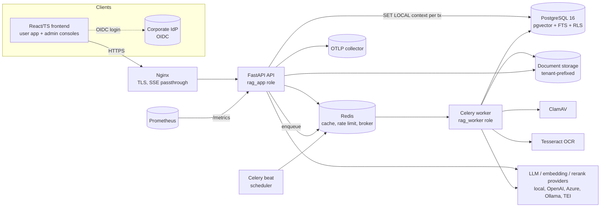
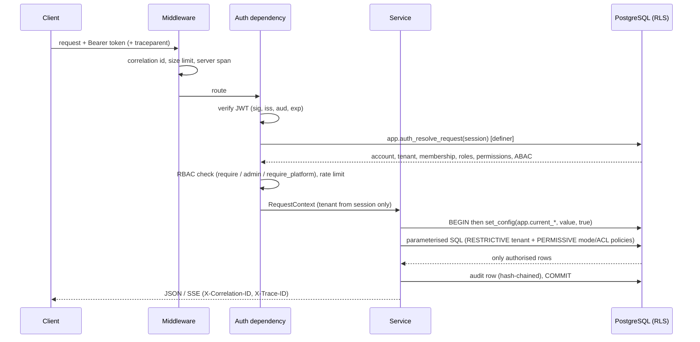

# Architecture overview

The decisions behind each element are recorded in `PROJECT_ARCHITECTURE_DECISIONS.md` (ADR-001 to ADR-018).

## 1. Runtime view

## 2. Request flow and security layers

## 3. Code layout (`backend/app`)

| Package | Responsibility |
|---|---|
| `api/v1` | FastAPI routers. Validation, dependency injection, calls into services; no business logic |
| `dependencies` | Authentication and authorisation dependencies (`get_context`, `require`, `require_any`, `require_platform`) |
| `security` | Passwords (scrypt), JWT, refresh tokens, TOTP, OIDC validation, Fernet secrets, `RequestContext` |
| `database` | Engines per role, `SecurityContext`, `scoped_session` (transaction-local context), role-safety check, bootstrap |
| `services` | Use-case logic and parameterised SQL: auth, identity, tenants, quotas, documents, search, chat, configuration, analytics, evaluation, platform, usage, audit |
| `rag` | `parsers`, `ocr`, `ingestion`, `chunking`, `embeddings`, `retrieval`, `hybrid_search` (RRF), `reranking`, `generation` (LangChain models, prompts), `citations`, `guardrails`, `evaluation` (metrics), `workflows` (LangGraph) |
| `workers` | Celery application, queues, beat schedule, tasks |
| `analytics` | Per-tenant scheduled aggregation into `ops.*_daily` |
| `integrations` | Storage, ClamAV, AI provider registry |
| `middleware` | Correlation, metrics, tracing, security headers, rate limiting |
| `observability` | Prometheus metrics, OpenTelemetry tracing |
| `core` | Settings (with the production guard), errors, logging (JSON + redaction), context variables |
| `schemas` | Pydantic v2 request and response models |

## 4. Data and isolation model

See `docs/database/DATABASE_DESIGN.md`, which has the ER diagram and the ownership matrix, and `docs/security/DATABASE_SECURITY.md`.

| Layer | What it enforces |
|---|---|
| 1. RLS | Tenant isolation in the database |
| 2. RBAC/ABAC | In dependencies and SQL context |
| 3. Resource ACLs | Denormalised principal arrays checked by `app.acl_visible()` on documents, chunks and embeddings |

## 5. RAG flow

See `docs/rag/RAG_PIPELINE.md`.

- **Ingestion** runs asynchronously per tenant: worker mode, then parse, OCR, chunk, embed and publish.
- **Retrieval** is hybrid (HNSW + FTS + exact), fused with RRF and re-authorised under RLS.
- **Generation** is a LangGraph state machine with guardrails, citation validation, abstention and degraded mode.
